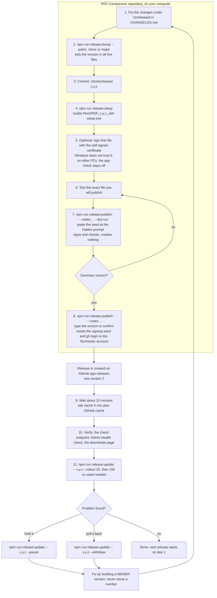
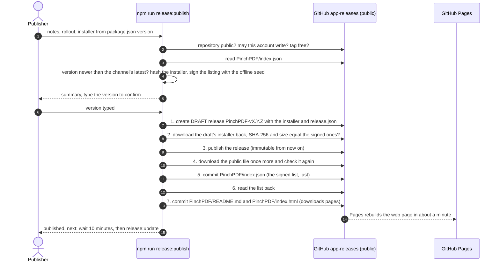
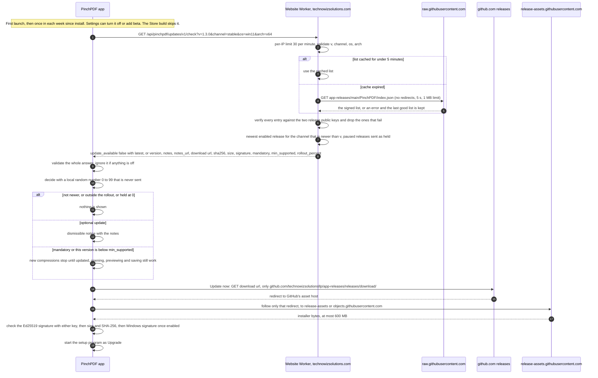
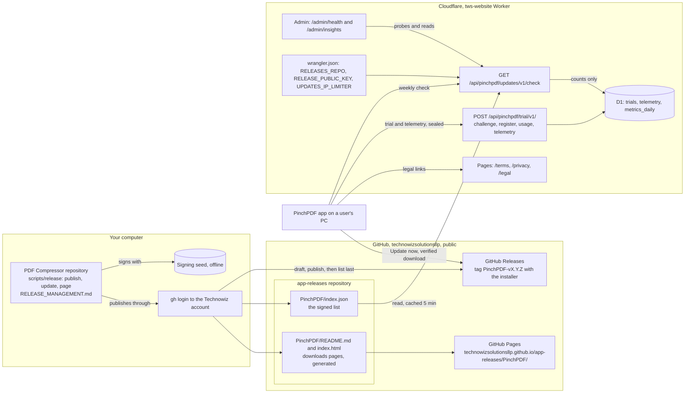
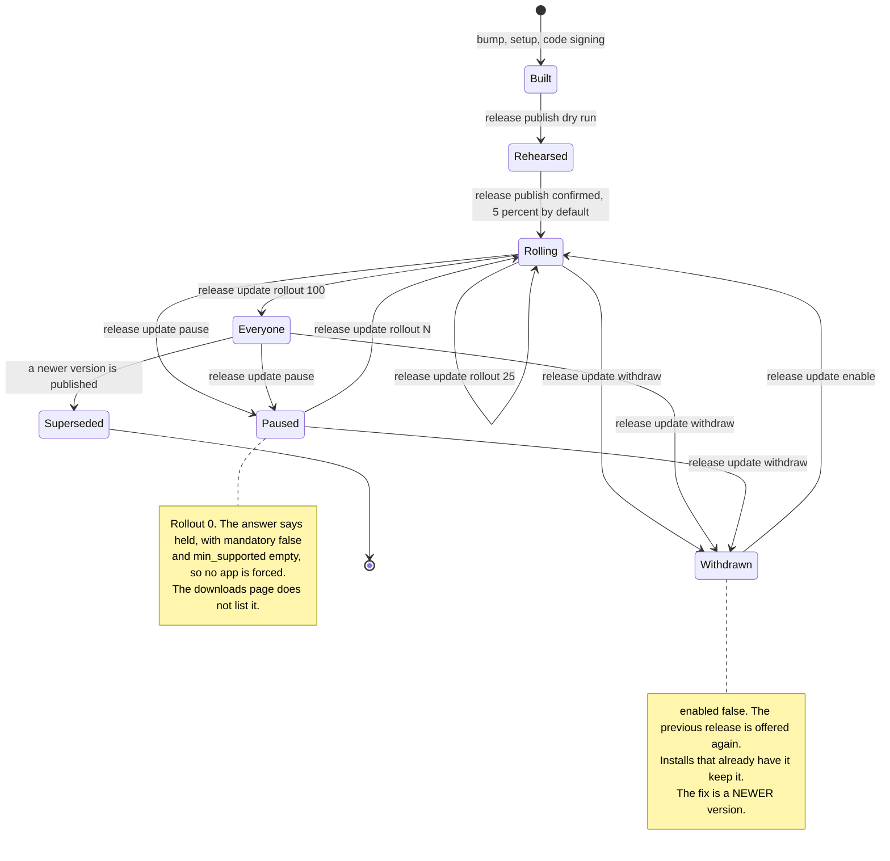
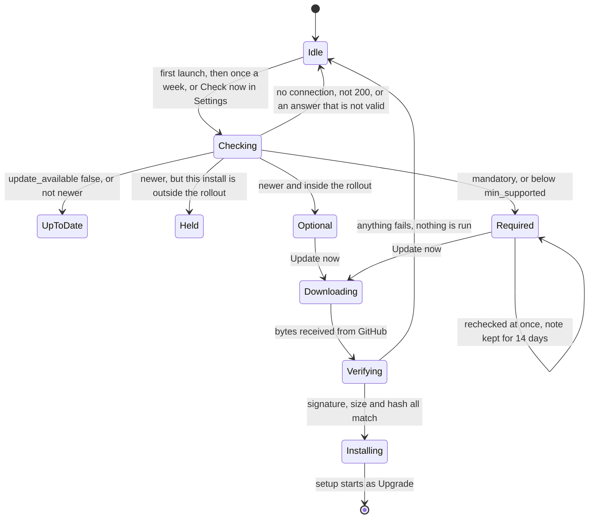

# PinchPDF release and update flow (final)

One page that shows how a PinchPDF release is pushed, which command to run when, where each step writes, what the website does with the result, and how the app finds, checks and installs it. It was checked against the code of this repository (`lib/updates/`, `scripts/release-*.mjs`) and against the PinchPDF app (`src-tauri/src/app_update.rs`, its tests and README) at version 1.3.0. NoDupe uses the same website code and the same scripts with its own names (`NoDupe`, `/api/nodupe/updates/v1/check`, `NoDupe_<version>_x64-setup.exe`).

Related: [RELEASES.md](RELEASES.md) (decisions, keys, rotation, setup record), `RELEASE_MANAGEMENT.md` in the PDF Compressor repository (the step-by-step page the publisher follows), [ARCHITECTURE.md](ARCHITECTURE.md).

Contents: [1 Pushing a release](#1-pushing-a-release-what-to-run-and-when) ([the exact signing command](#11-the-signing-script-exactly-what-to-run)) · [2 What publish writes](#2-what-publish-writes) · [3 The updater flow](#3-the-updater-flow-app-website-github) · [4 Where everything lives](#4-where-everything-lives) · [5 Life of a release](#5-life-of-a-release) · [6 Inside the app](#6-inside-the-app) · [7 Addresses and pages](#7-addresses-and-pages) · [8 Alignment check](#8-alignment-check-app-and-website)

## 1. Pushing a release: what to run and when

Everything on the left runs **on your computer**, in the PDF Compressor repository. The website is never deployed to publish a release.



| When | Command (PDF Compressor repo) | Where it writes |
|---|---|---|
| Before every release build | `npm run release:bump -- patch\|minor\|major` | The five version files and `CHANGELOG.md` in the repository |
| To build the installer | `npm run release:setup` | `src-tauri/target/release/bundle/setup/PinchPDF_<version>_x64-setup.exe` |
| To rehearse | `npm run release:publish -- --notes "a\|b" --dry-run` | Nothing public; local copies in `release-out/` (git-ignored) |
| To publish | `npm run release:publish -- --notes "a\|b" [--rollout 5] [--channel beta]` | GitHub `app-releases`: the release, `PinchPDF/index.json`, `PinchPDF/README.md`, `PinchPDF/index.html` |
| After publishing | `npm run release:update -- <version> --rollout 25` (also `--pause`, `--withdraw`, `--enable`, `--mandatory`, `--min-supported`, `--notes`) | The same list and pages; the installer is never touched |
| After editing the list by hand | `npm run release:page` | The two downloads pages |
| To deploy a website change | Merge a pull request in the website repository | Cloudflare (see "What runs when" in [RELEASES.md](RELEASES.md)) |

### 1.1 The signing script: exactly what to run

Signing happens inside `release:publish` (there is no separate signing command). It runs only on your computer, in the PDF Compressor repository (PinchPDF) or the Duplicate Cleaner repository (NoDupe). Both repositories hold byte-identical copies of the same script. The seed (the 43-character secret of the primary key) is asked for by `release:publish`, **including the dry run**, because the dry run signs the entry to show you the result. `release:update` and `release:page` never need it.

**How the seed is given:** it is **typed (pasted) at a hidden prompt** each time you run `release:publish`. It is deliberately **not** read from an environment variable, a file or a command line option (those leave it where other programs and the shell history can read it), and `--key-file` no longer exists. Keep the seed in your password manager and paste it when asked. A piped or scheduled run is refused because there is no one to type it.

**Before you start** (PowerShell, in the product repository):

```powershell
gh auth status                                  # must list technowizsolutionsllp
```

**1. Rehearse** (signs, checks, prints the summary, creates nothing). It asks for the seed:

```powershell
npm run release:publish -- --notes "Faster compression|Fixed a crash on encrypted files" --rollout 5 --dry-run
```

```text
Signing seed (43 characters, nothing is shown while you paste it):    <paste, Enter>
```

**2. Publish** (the same command without `--dry-run`; it asks for the seed again, then asks you to type the version):

```powershell
npm run release:publish -- --notes "Faster compression|Fixed a crash on encrypted files" --rollout 5
```

There is nothing to clean up afterwards: the seed was never stored in a variable or a file.

With no version or file given, the script takes the version from `package.json` and the installer `src-tauri/target/release/bundle/setup/PinchPDF_<version>_x64-setup.exe` (NoDupe: its own installer path). A version that differs from `package.json` is refused. The command line is the same for NoDupe; only the repository changes.

What gets signed (the bytes are `pinchpdf-release-v1|<Product>|<channel>|<version>|<sha256>|<size>`): the script hashes the installer file, builds that line and signs it with the seed using Ed25519. The signature goes into the entry of `index.json`; the seed itself is never written anywhere.

| Option | Needed? | Meaning | Default |
|---|---|---|---|
| `--notes "a\|b"` | **Yes** | The major changes, separated by `\|`, 1 to 10 lines of up to 200 characters | |
| `--rollout N` | No | Percent of users offered it, 0 to 100 (a mandatory release ignores it and goes to everyone) | `5` |
| `--channel stable\|beta` | No | `beta` needs a version such as `1.4.0-beta.1`; stable has no suffix | `stable` |
| `--dry-run` | No | Check and show the summary, create nothing | off |
| `--notes-url https://technowizsolutions.com/...` | No | Full release notes. Must be on `technowizsolutions.com`; the app refuses the whole answer for any other address | none |
| `--min-supported 1.1.0` | No | Apps older than this are told to update | none |
| `--mandatory` | No | Every app must update at once, whatever the rollout (a pause still holds it) | off |
| `--allow-older` | No | Allow a version not higher than the channel's latest (hotfix on an older line) | off |
| `--yes` | No | Skip the typed confirmation (not for routine use) | off |
| `--repo owner/name`, `--branch main` | No | Another releases repository or branch | `technowizsolutionsllp/app-releases`, `main` |
| `--out folder` | No | Where local copies of `release.json` and `index.json` go (git-ignored) | `release-out` |
| `--site url`, `--no-site-check` | No | The one check of the website at the end | `https://technowizsolutions.com`, on |

Typical cases:

| Release | Command (after the session setup above) |
|---|---|
| Normal stable, small first rollout | `npm run release:publish -- --notes "a\|b" --rollout 5` |
| Beta for testers | `npm run release:publish -- --notes "a\|b" --channel beta` (version `1.4.0-beta.1`) |
| Security fix everyone must install | `npm run release:publish -- --notes "a\|b" --mandatory --notes-url https://technowizsolutions.com/...` |
| Drop support for old versions | `npm run release:publish -- --notes "a\|b" --min-supported 1.2.0` |

**After publishing** (no seed is asked for; wait about 10 minutes first):

```powershell
npm run release:update -- 1.3.0 --rollout 25      # then --rollout 100
npm run release:update -- 1.3.0 --pause           # hold it
npm run release:update -- 1.3.0 --withdraw        # pull it back (--enable brings it back)
```

Other `release:update` options: `--mandatory`, `--not-mandatory`, `--min-supported v`, `--clear-min-supported`, `--notes "a|b"`, `--notes-url url`, `--dry-run`, `--yes`. A wrong seed, a missing seed, a private repository, a missing write permission, an existing tag or a version that is not newer each stop the script before anything is public.

## 2. What publish writes

The order is fixed so that nothing is public until it has been checked, and the list (what apps are offered) is always last.



If a step before 3 fails, nothing is public. If step 4 fails, the release is public but the list is not, so no app is offered it. If step 7 fails, the release and the list are fine and the script tells you to run `npm run release:page`.

## 3. The updater flow: app, website, GitHub



What the website records: only a count of checks per day and outcome (`update_check` in `metrics_daily`), never an address, id or version.

## 4. Where everything lives



## 5. Life of a release



## 6. Inside the app



## 7. Addresses and pages

**What the PinchPDF app talks to**

| Address | Method | Purpose |
|---|---|---|
| `https://technowizsolutions.com/api/pinchpdf/updates/v1/check?v=&channel=&os=&arch=` | GET, plain | The update check. No id, no personal data |
| `https://technowizsolutions.com/api/pinchpdf/trial/v1/challenge`, `register`, `usage` | POST, sealed (challenge plain) | Free trial |
| `https://technowizsolutions.com/api/pinchpdf/trial/v1/telemetry` | POST, sealed | Buy clicks (opt-in) and license events |
| `https://technowizsolutions.com/terms#schedule-a-trial`, `/privacy#pinchpdf-trial`, `/terms#software-license` | Opened in the browser | Legal texts the app links to |
| `https://github.com/technowizsolutionsllp/app-releases/releases/download/PinchPDF-vX.Y.Z/<file>` | GET, one redirect to GitHub's asset host | The installer, only from the update answer |

**What the website reads and serves for updates**

| Address | Who | Purpose |
|---|---|---|
| `https://raw.githubusercontent.com/technowizsolutionsllp/app-releases/main/PinchPDF/index.json` (and `NoDupe/`) | The Worker, cached 5 minutes, last good list kept | The signed list. The only host it fetches |
| `/admin/health` (App updates, probes of both check endpoints) | The operator, behind the admin login | Shows what is missing or invalid |
| `/api/pinchpdf/trial/docs` | The operator, behind a login | The Swagger description of every endpoint |

**Public downloads pages (for people)**

| Address | Content |
|---|---|
| `https://technowizsolutionsllp.github.io/app-releases/PinchPDF/` | Web page: current version, newest beta, every available version with link, size, SHA-256 and notes |
| `https://github.com/technowizsolutionsllp/app-releases/tree/main/PinchPDF` | The same as the GitHub folder page (`README.md`) |
| `https://technowizsolutionsllp.github.io/app-releases/` | Index of the products |
| `https://github.com/technowizsolutionsllp/app-releases/releases` | Every release and installer of both products |

## 8. Alignment check (app and website)

Checked by reading `app_update.rs`, its tests and shared vectors against the website code. "Fixed" means the website was changed to match; nothing in the app was changed.

| Topic | App (PinchPDF 1.3.0) | Website | Status |
|---|---|---|---|
| Signed bytes | `pinchpdf-release-v1\|PinchPDF\|channel\|version\|sha256\|size` | Same | Aligned. The shared vectors file is byte-identical in the app (`src-tauri/src/app_update/release-vectors.json`), in `scripts/release/` and in the website |
| Release keys | Two public keys, primary and backup, either verifies | `RELEASE_PUBLIC_KEY` holds the same two keys | Aligned (an app test keeps the bytes equal to the strings) |
| Request | `v`, `channel`, `os` (`win10`, `win11`, `win`), `arch` (`x64`, `arm64`, `x86`) | Accepts those, tokens up to 16 characters | Aligned |
| When it asks | First launch, then once in each week since install; Settings can turn it off | No fixed cadence needed; list cached 5 minutes, 30 requests per minute per IP | Aligned |
| Answer fields | Reads `update_available`, `latest`, `product`, `version`, `channel`, `pub_date`, `notes`, `notes_url`, `download`, `min_supported`, `mandatory`, `rollout_percent`; refuses the whole answer if anything is off | Sends exactly those | Aligned |
| Download | Only `github.com/technowizsolutionsllp/app-releases/releases/download/`, redirect only to GitHub's asset hosts, at most 600 MB | The URL is built from `RELEASES_REPO` and the validated file name | Aligned |
| Installer name | `PinchPDF_<version>_x64-setup.exe` | `release:setup` produces that name and the publish script uses it | Aligned |
| Notes | At most 10 lines of 300 characters | At most 10 lines of 200 characters | Aligned (the website is stricter) |
| Release notes link | **Refuses the whole answer** if `notes_url` is not on `technowizsolutions.com` | Used to accept any https address | **Fixed**: publishing refuses such a link, and the website leaves a foreign link out of the answer and reports it in the Health check |
| Pause | An install below `min_supported` is forced even at rollout 0, because the app decides it on its own copy | Pause (rollout 0) is meant to hold everything | **Fixed on the website side**: a paused release is answered with `mandatory` false and `min_supported` empty. The app could also treat rollout 0 as a hold; that is the app team's call |
| Mandatory | Stops new compressions until updated; a note lasts 14 days and is rechecked at once | Sends `mandatory` true and rollout 100 | Aligned |
| Beta | A stable install refuses a beta answer | Filters by channel | Aligned |
| Windows signature | Check exists and is switched off (`REQUIRE_AUTHENTICODE` false). A self-signed, permanent certificate exists (publisher `Technowiz Solutions LLP`), but Windows only reports `Valid` where the certificate is trusted, so the check would refuse every update on other computers | Not involved | Aligned. Stays off until a certificate from a trusted authority exists |
| Microsoft Store build | Skips the check | Not involved | Aligned |
| Privacy text | Sends version, channel, Windows family and architecture | Section 2.8 of `/privacy` says the same, plus the User-Agent carries only the app version | Aligned; the paragraph is still a draft for counsel |

Open items: a Windows certificate from a trusted authority (the self-signed one is not trusted on other computers, so the app's check stays off), counsel review of privacy section 2.8, and the first real release (the draft, check, publish sequence has only run against a test double and as a dry run).
