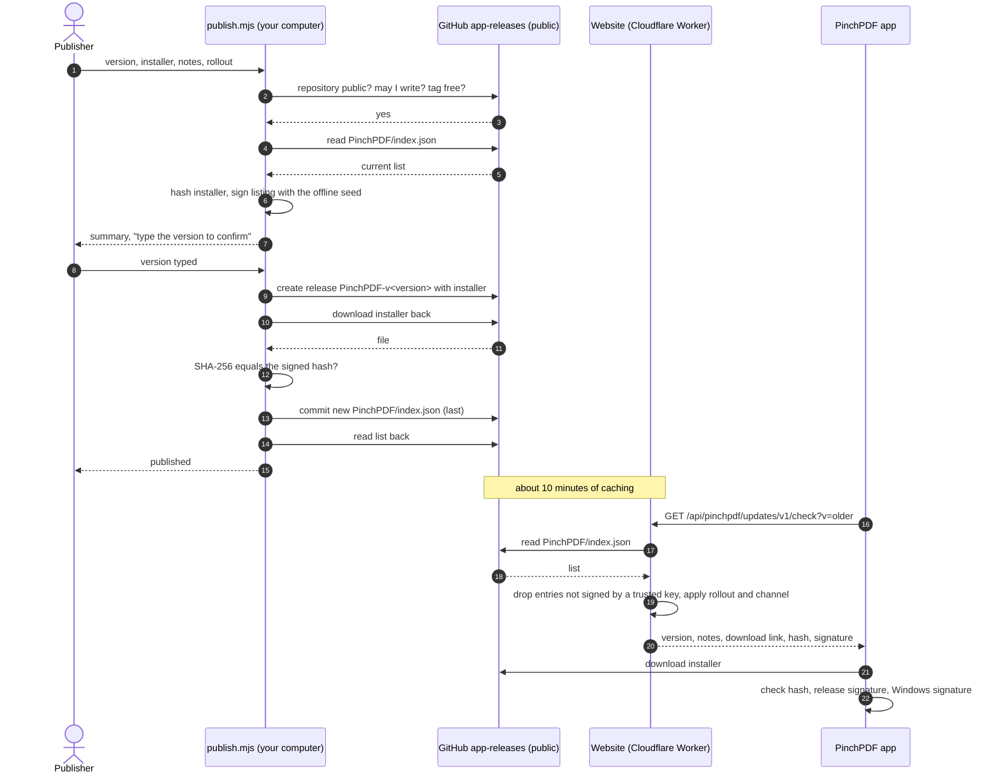
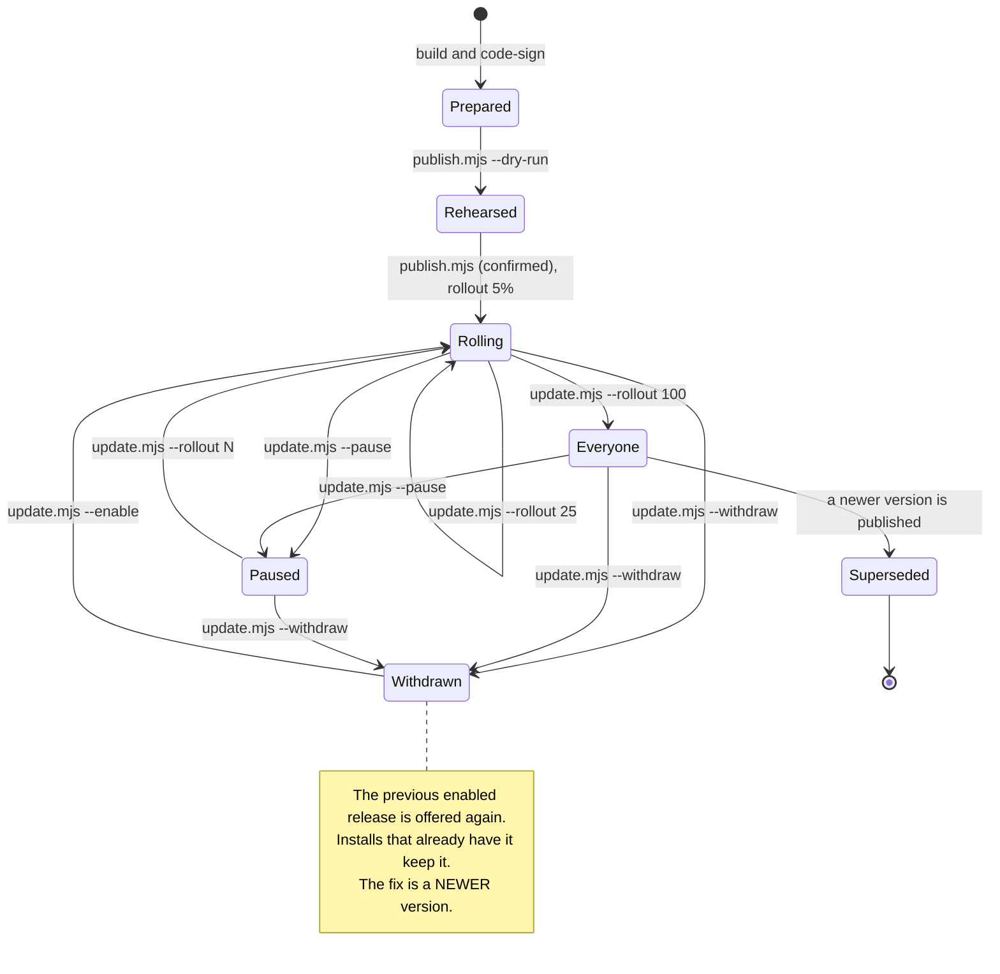
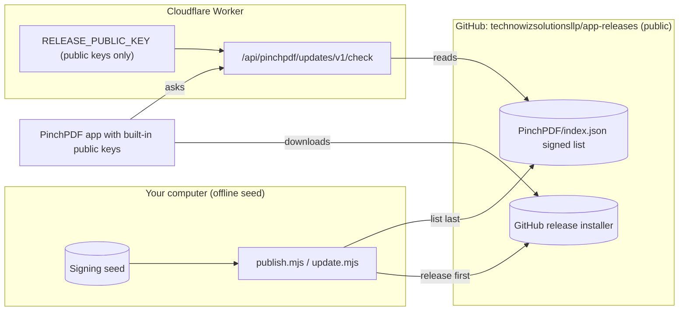

# PinchPDF release management

How a new version of **PinchPDF** gets from your build machine to your users, step by step. You can follow this page on its own; deeper background is in [docs/RELEASES.md](../../docs/RELEASES.md), section B.

**In one sentence:** you build and code-sign the installer, run one command that signs the release listing, puts the installer on GitHub and publishes the list, then you watch it roll out to more and more users.

## Contents

1. [Who and what is involved](#1-who-and-what-is-involved)
2. [Set up once](#2-set-up-once)
3. [Release a new version](#3-release-a-new-version)
4. [Change a release afterwards](#4-change-a-release-afterwards)
5. [Rules](#5-rules)
6. [If something goes wrong](#6-if-something-goes-wrong)
7. [Diagrams](#7-diagrams)
8. [Options reference](#8-options-reference)
9. [Release checklist](#9-release-checklist)

## 1. Who and what is involved

| Who or what | Role |
|---|---|
| **You (the publisher)** | Build the installer, run the commands here, hold the signing seed |
| **Your computer** | The only place the signing seed is ever used. Never a server, never CI |
| **GitHub repository `technowizsolutionsllp/app-releases`** (public) | Holds the installer (as a GitHub release `PinchPDF-v<version>`) and the signed list `PinchPDF/index.json` |
| **The website** (`technowizsolutions.com`) | Reads the list, ignores any entry that was not signed by a trusted key, and answers the apps at `/api/pinchpdf/updates/v1/check` |
| **The PinchPDF app** | Asks the website whether a newer version exists, downloads it, checks the hash, the signature and the Windows code signature, then installs |

Two signatures protect an installer, and they are different:

- **Windows code signing (Authenticode):** you sign the `.exe` when you build it. This is what Windows and SmartScreen check.
- **Release signature (Ed25519):** the script signs the *listing* (product, channel, version, file hash and size) with your offline seed. The website and the app check it. This is what stops anyone with access to the GitHub repository from offering a file you did not sign.

## 2. Set up once

Do these once on the computer you publish from.

1. **Install Node.js 24 or newer** and the **GitHub CLI** (`winget install GitHub.cli`).
2. **Sign the CLI in to the Technowiz GitHub account** (the account that owns the releases repository, not your personal one):

   ```powershell
   gh auth login
   gh auth status
   ```

   `gh auth status` must list `technowizsolutionsllp`. The scripts find that saved login by themselves; you do not need to switch accounts.
3. **Have the signing seed ready, kept offline.** It is the 43-character secret from `node scripts/release-prepare.mjs --keygen` (the *primary* key). Keep it in your password manager or an encrypted file, **never** in this repository, Cloudflare, GitHub or chat. For each publishing session, either:

   ```powershell
   $env:RELEASE_SIGNING_KEY = "<paste the seed>"     # lives only in this PowerShell window
   ```

   or save it in a text file on an encrypted drive and pass `--key-file D:\keys\primary.txt`.
4. **Get this repository** (the website code) on the computer, so the scripts are available: `npm install` once.

## 3. Release a new version

Example: release version `1.3.0` as a small first rollout. Replace the file name and notes with yours.

### Step 1: decide the version and channel

| | |
|---|---|
| **Version** | `MAJOR.MINOR.PATCH`, higher than the last one in the same channel. A bug fix is a patch (`1.3.1`), a feature a minor, a breaking change a major |
| **Channel** | `stable` for everyone, `beta` for opt-in testers. A beta version has a suffix such as `1.3.0-beta.1`. Stable versions never have a suffix |
| **Notes** | 1 to 10 short plain lines, written for users: the major changes |
| **Rollout** | Start small (5%), then raise it. See step 6 |

### Step 2: build and code-sign the installer

Build the installer and sign it with your Windows code-signing certificate. Name it `PinchPDF-1.3.0-x64.exe`. Keep the **exact file you tested**: the release signs its hash, so rebuilding afterwards means a different file.

### Step 3: rehearse with a dry run

A dry run checks everything and changes nothing:

```powershell
node releases/PinchPDF/publish.mjs 1.3.0 .\PinchPDF-1.3.0-x64.exe --notes "Faster compression|Fixed a crash on encrypted PDFs" --rollout 5 --dry-run
```

It checks the repository is public and you may write to it, that the version and tag are free, that the version is newer, signs the entry, and prints a summary. Read it. Nothing is created on GitHub.

### Step 4: publish

Run the same command without `--dry-run`:

```powershell
node releases/PinchPDF/publish.mjs 1.3.0 .\PinchPDF-1.3.0-x64.exe --notes "Faster compression|Fixed a crash on encrypted PDFs" --rollout 5
```

It prints the same summary, then asks you to **type the version to confirm**. Anything else cancels. After you confirm it does four things, always in this order:

1. **Creates the GitHub release** `PinchPDF-v1.3.0` with the installer (and a small `release.json`) attached.
2. **Downloads the installer back** from GitHub and checks its SHA-256 and size against what you signed. If they differ it stops and the list is never touched.
3. **Publishes `PinchPDF/index.json`** (a normal commit on `main`). The list always goes last, so it never points at a file that does not exist yet. If someone else changed the list meanwhile, it retries on top of their change.
4. **Reads the list back** and confirms your entry is in it.

For a beta add `--channel beta` (and a `-beta.N` version); the GitHub release is marked as a pre-release.

### Step 5: verify (after about 10 minutes)

The website caches the list for about 5 minutes and GitHub for a few more, so wait about 10 minutes. Then ask the website as an older version of the app would:

```powershell
Invoke-RestMethod "https://technowizsolutions.com/api/pinchpdf/updates/v1/check?v=0.0.1&channel=stable"
```

You should see `update_available: true`, your version, the notes and a download link. Open **Admin, Health check**: *App updates* should be green. The script also tries this check once at the end and tells you if the website does not offer it yet (normal in the first minutes).

### Step 6: raise the rollout

Apps receive `rollout_percent`; each app compares it with a random number it keeps locally, so about that share of users is offered the update. A common schedule: 5%, then 25%, then 100% over a few days while you watch support requests.

```powershell
node releases/PinchPDF/update.mjs 1.3.0 --rollout 25
node releases/PinchPDF/update.mjs 1.3.0 --rollout 100
```

Changing the rollout needs no signing seed. Each change is a git commit with a time and an author, so the history of every rollout decision is on GitHub.

## 4. Change a release afterwards

Use `update.mjs`. It changes only the unsigned switches; the installer, hash, size and signature are never touched. Add `--dry-run` to preview, `--yes` to skip the typed confirmation.

| I want to | Command | Effect |
|---|---|---|
| Raise or lower the rollout | `node releases/PinchPDF/update.mjs 1.3.0 --rollout 25` | About 25% of users are offered it |
| **Pause** (hold, something looks wrong) | `node releases/PinchPDF/update.mjs 1.3.0 --pause` | Rollout 0: nobody new is offered it, and no older version is offered instead |
| **Withdraw** (pull it back) | `node releases/PinchPDF/update.mjs 1.3.0 --withdraw` | The previous enabled release is offered again |
| Bring a withdrawn release back | `node releases/PinchPDF/update.mjs 1.3.0 --enable` | |
| Force everyone to update | `node releases/PinchPDF/update.mjs 1.3.0 --mandatory` | The app must update before it continues. Use sparingly and say why in the notes |
| Cut off old, insecure versions | `node releases/PinchPDF/update.mjs 1.3.0 --min-supported 1.1.0` | Apps below that version are told to update |
| Fix the wording of the notes | `node releases/PinchPDF/update.mjs 1.3.0 --notes "New line|Another line"` | |

Changes take effect within about 10 minutes. **Installs that already have the release keep it**, so a real fix is always a **newer version**, published as in section 3, never a reused number.

## 5. Rules

- **A released version is never replaced or reused.** A fix is a new version. The script refuses a version that already exists.
- **A new version must be higher** than everything already in the same channel (the script refuses otherwise; `--allow-older` is for a deliberate hotfix on an older line).
- **Every release that reaches users is signed**, stable and beta alike. The app must refuse an unsigned or wrongly signed release, and there is no setting to skip the check.
- **Only releases you decide to ship are signed.** Test builds are never signed with the release key and never go in the list; give them to testers directly.
- **The seed never leaves your control:** not in Cloudflare, not in GitHub (code or secrets), not in CI, not in chat or email. If it may have leaked, follow "Key rotation" in [docs/RELEASES.md](../../docs/RELEASES.md).
- **The repository stays public and holds no code.** The script refuses to publish to a private repository.
- **The owner and name of the repository are permanent.** They are part of the app's download allowlist.

- **Microsoft Store builds** are updated by the Store, so the app does not use this update check there. Publish them through the Store, not through this process.

## 6. If something goes wrong

| What you see | What it means | What to do |
|---|---|---|
| `... is not public` | The repository was made private | Make `app-releases` public again; releases must be public |
| `cannot write to ...` / `cannot see ...` | The GitHub account in use cannot write to the repository | `gh auth status`; sign in to the Technowiz account with `gh auth login` |
| `a GitHub release ... already exists` | That version was already published (or half published) | Publish a **new** version. Look at the release page first |
| `... is already in the list` / `is not newer than ...` | The version is not higher than what is listed | Use a higher version |
| `the signing seed is missing` | `RELEASE_SIGNING_KEY` or `--key-file` not given | Set the seed for this PowerShell session |
| `unknown option --...` | A typo in an option | Fix it. Unknown options are refused on purpose, so a typo never publishes at 100% |
| `the GitHub release was not created` | GitHub refused the upload | Nothing was published. Read the message, fix it, run again |
| `STOP: the file GitHub serves ... does not match` | The uploaded file is not the one you signed | The list was **not** published, so no app is offered it. Do not reuse that version number: build again and publish a new version |
| `the GitHub release ... IS created, but the list was not published` | The installer is up but the list write failed | Nothing else to redo. Publish `release-out/PinchPDF/index.json` as `PinchPDF/index.json` on `main` (GitHub web editor, commit to `main`), or run `update.mjs` once it is listed |
| The website does not offer the release after 15 minutes | List or key problem | Open **Admin, Health check**, *App updates*: it names the problem (for example an entry whose signature does not verify against the keys the website trusts) |
| I published something wrong | | `--pause` or `--withdraw` it at once (section 4), then publish a corrected, newer version |

## 7. Diagrams

### Publishing a release (sequence)



### Life of a release (state)



### Who holds what (components)



## 8. Options reference

**`publish.mjs <version> <installer.exe> --notes "a|b" [options]`**

| Option | Meaning | Default |
|---|---|---|
| `--notes "a\|b"` | The major changes, one per `\|`-separated part (required) | |
| `--channel stable\|beta` | Release channel | `stable` |
| `--rollout N` | Percent of users offered it, 0 to 100 | `100` |
| `--notes-url https://...` | Link to the full release notes | none |
| `--min-supported 1.1.0` | Apps below this version are told to update | none |
| `--mandatory` | The app must update before it continues | off |
| `--dry-run` | Check and show the summary only | off |
| `--yes` | Skip the typed confirmation (not for routine use) | off |
| `--allow-older` | Allow a version not higher than the channel's latest (hotfix on an older line) | off |
| `--key-file path` | Read the seed from a file instead of `RELEASE_SIGNING_KEY` | |
| `--repo owner/name`, `--branch main` | Another releases repository or branch | `technowizsolutionsllp/app-releases`, `main` |
| `--out folder` | Where local copies of `release.json` and `index.json` are written | `release-out` |
| `--no-site-check` | Skip the one check of the website at the end | off |

**`update.mjs <version> [options]`**: `--rollout N`, `--pause`, `--withdraw`, `--enable`, `--mandatory`, `--not-mandatory`, `--min-supported v`, `--clear-min-supported`, `--notes "a|b"`, `--notes-url url`, `--dry-run`, `--yes`, `--repo`, `--branch`.

The same scripts work for both products: `node scripts/release-publish.mjs <PinchPDF|NoDupe> ...` and `node scripts/release-update.mjs <PinchPDF|NoDupe> ...`. The wrappers in this folder just fix the product.

## 9. Release checklist

- [ ] Version chosen (higher than the last in its channel), notes written
- [ ] Installer built, tested and code-signed (the exact file you will publish)
- [ ] Signed in to the Technowiz GitHub account (`gh auth status`); seed set for this session
- [ ] `--dry-run` read and correct
- [ ] Published and confirmed; the script finished with "Published"
- [ ] After about 10 minutes: the check endpoint offers it to an older version; Health check green
- [ ] Rollout raised step by step (5, 25, 100) while watching support
- [ ] Seed removed from the session (`Remove-Item Env:RELEASE_SIGNING_KEY`)
- [ ] Privacy and store text still accurate
